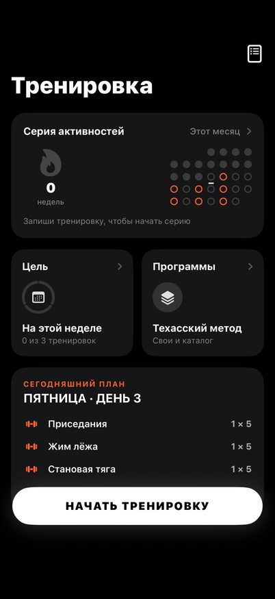
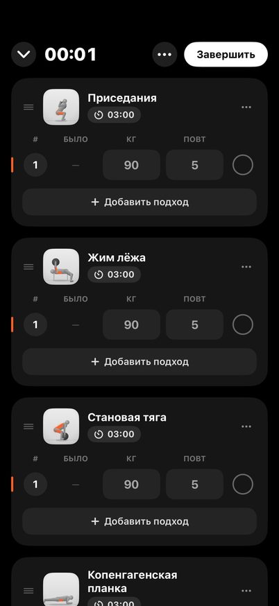
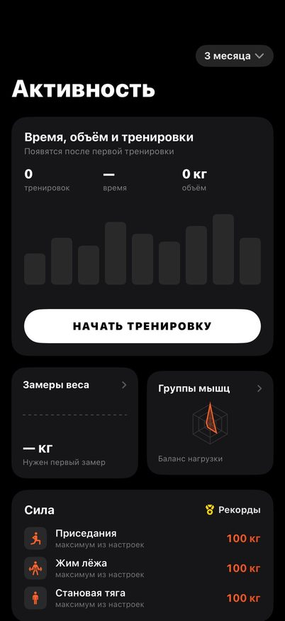
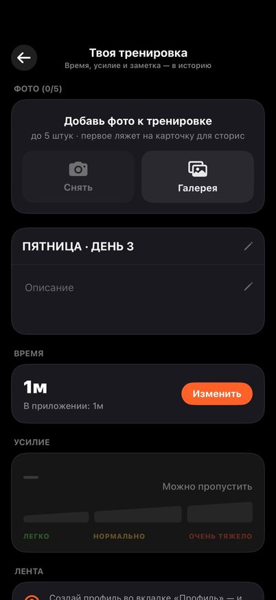
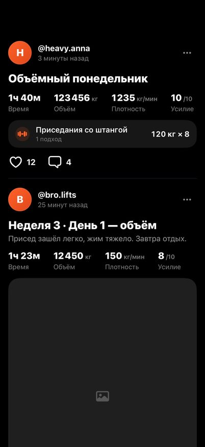
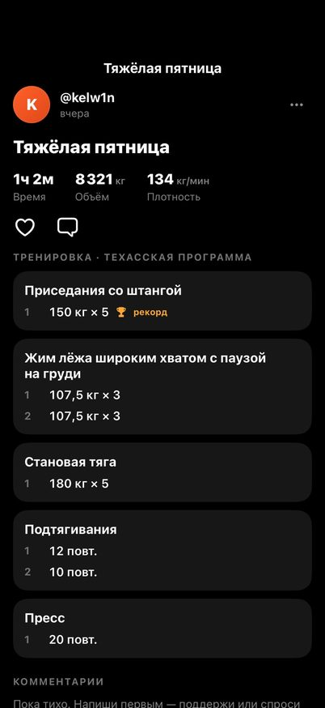
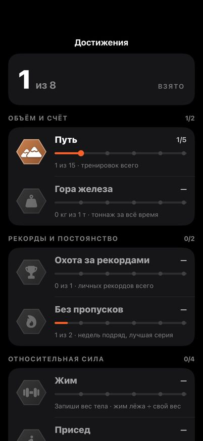

# STRAIN

Силовые тренировки по программе. Для iPhone и Android.

STRAIN рассчитывает рабочие веса, ведёт тренировку от разминки до последнего подхода
и показывает прогресс. Питание, ИИ-тренер и друзья — в том же приложении.

  
  
  
  

  
  
  
  

## Программы

| Программа | Длительность | Основа расчёта |
| --- | --- | --- |
| Техасский метод | 12 недель, 3 тренировки | 5ПМ |
| Верх / Низ | 7 недель, 4 тренировки | 1ПМ, волна жима |
| Фулбади | 12 недель | рабочие веса |
| Продвинутый техас | 20 недель, двухнедельные блоки | 5ПМ |
| Эвтаназия худобы | 8 недель | плотность |
| Своя программа | любая | свои упражнения и схема |

Несколько профилей — у каждого своя программа, максимумы и история.

## Тренировка

- Вес и повторы вводятся с клавиатуры. Прошлый результат подставляется сам.
- Разминочные подходы для штанги и раскладка блинов.
- Таймер отдыха запускается после подхода — в Dynamic Island и на экране блокировки, на Android — в уведомлении.
- Замена упражнения, если тренажёр занят. Порядок меняется перетаскиванием.
- Шаг прибавки, предупреждение о застое, ползунок усилия.
- Тренировка сохраняется, даже если закрыть приложение.
- Итоги: время, объём, рекорды, заметка, фото и карточка для сторис.

## Прогресс

- Серия, календарь месяца и цель недели с напоминаниями.
- Объём, личные рекорды, график приседа, жима и тяги.
- Вес тела и сила относительно веса. На iPhone — с Apple Здоровьем.
- Уровни, достижения и итоги месяца и года.

## Питание

- Калории и БЖУ на день по параметрам и цели.
- Еда по фото: распознавание через Google Gemini с твоим ключом.
- Трекер добавок.

## ИИ-тренер

Отвечает на вопросы о застое, прогрессе, восстановлении и питании. Видит твою программу,
подходы за полтора месяца, вес тела и питание. Изменения в программе предлагает —
применяешь их сам. Работает на Google Gemini с твоим ключом.

## Друзья

- Лента тренировок с фото, лайками и комментариями.
- Чаты с голосовыми сообщениями.
- Совместные тренировки, челленджи и рейтинг недели.
- Копирование программы или тренировки из чужого поста.
- Без сети пост и сообщения ждут на телефоне и отправляются сами.

## Установка

Последние сборки — в [Releases](../../releases).

- **iPhone** — `STRAIN.ipa`, устанавливается через SideStore, Sideloadly или iloader. С бесплатным Apple ID приложение переподписывается раз в 7 дней.
- **Android** — `STRAIN.apk`. Дальше приложение обновляется само, данные сохраняются.

Требования: iOS 17 и новее, Android 8 и новее.

## Устройство

| Папка | Что внутри |
| --- | --- |
| `TexasProgram/` | iPhone: Swift, SwiftUI, SwiftData |
| `StrainWidgets/` | виджет и Live Activity таймера отдыха |
| `android/` | Android: Kotlin, Jetpack Compose |
| `server/` | сервер ленты и чатов: Node.js, PostgreSQL — см. [server/README.md](server/README.md) |
| `TexasProgramTests/` | тесты iOS |

Сборки, тесты и снимки экранов делает GitHub Actions.

---

Стартовые веса в программах — примерные. Перед началом определи свой 5ПМ или 1ПМ.
STRAIN не заменяет консультацию тренера или врача.
