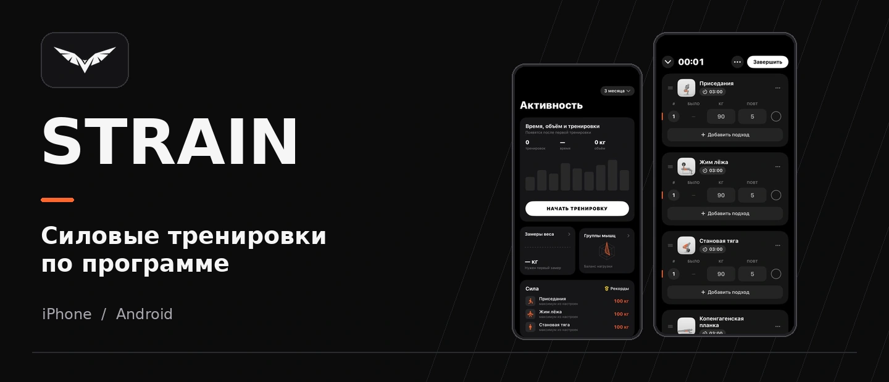
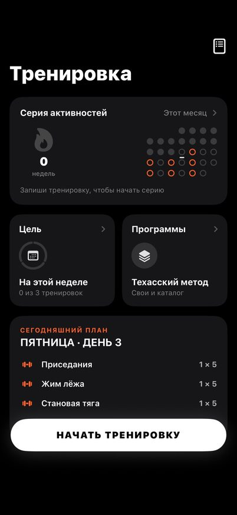
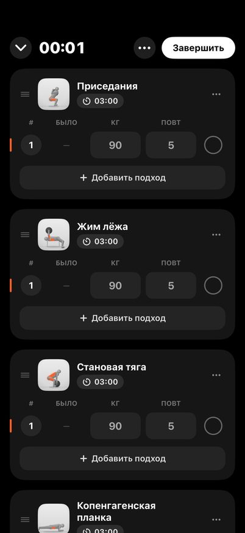
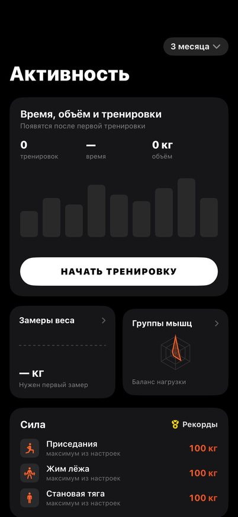
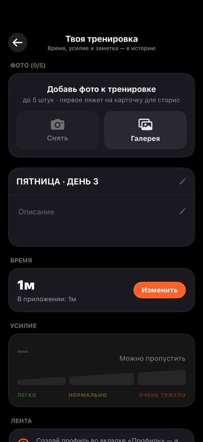
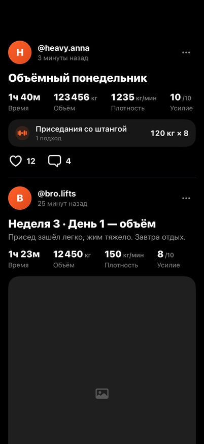
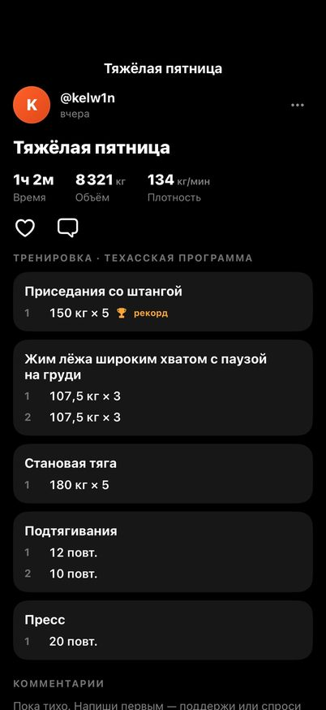
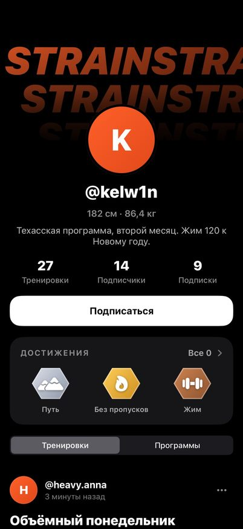
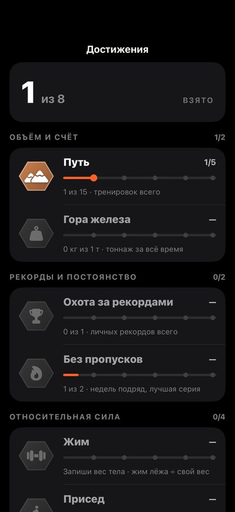

  

<h1 align="center">STRAIN</h1>

  
  

**STRAIN помогает вести силовые тренировки по программе.** Выбери готовый план или создай свой, укажи исходные максимумы и получи рабочие веса на тренировку. В зале приложение подскажет разминку и запустит таймер отдыха, а после покажет объём, рекорды и динамику результатов.

[Возможности](#возможности) · [Программы](#программы) · [Скриншоты](#скриншоты) · [Установка](#установка) · [Устройство проекта](#устройство-проекта)

## Возможности

| Раздел | Что можно делать |
| --- | --- |
| **Тренировка** | Записывать вес и повторы с подстановкой прошлого результата, рассчитывать разминочные подходы и раскладку блинов, заменять и переставлять упражнения. Незавершённая тренировка сохраняется при закрытии приложения. |
| **Прогрессия** | Настраивать шаг прибавки веса, отмечать усилие и отслеживать предупреждения о застое. Для жима есть волна **«Жим 14»**. |
| **Отдых и итоги** | Запускать таймер после подхода и следить за ним на экране блокировки и в Dynamic Island на совместимом iPhone или через уведомление Android. Добавлять заметку и фото к итогам и оформлять карточку для сторис. |
| **Прогресс** | Смотреть календарь, серию тренировок, недельную цель с напоминаниями, объём и личные рекорды. Отслеживать вес тела и относительную силу. На iPhone есть интеграция с Apple Здоровьем. Также доступны уровни, достижения и итоги месяца и года. |
| **Питание** | Рассчитывать дневные калории и БЖУ, распознавать еду по фото и вести трекер добавок. Для распознавания нужна настройка Google Gemini со своим ключом. |
| **ИИ-тренер** | Обсуждать прогресс, застой, питание и восстановление с Google Gemini. Тренер учитывает программу, тренировки за последние полтора месяца, вес тела и питание. Для работы нужен свой ключ Gemini. Предложенные изменения применяются вручную. |
| **Друзья** | Публиковать тренировки, общаться в чатах с голосовыми сообщениями, проводить совместные тренировки, участвовать в челленджах и недельных рейтингах, копировать планы из постов. Публикации и сообщения, созданные офлайн, отправляются после подключения. |

## Программы

| Программа | Длительность | Как подбираются веса |
| --- | --- | --- |
| **Техасский метод** | 12 недель, 3 тренировки в неделю | По 5ПМ |
| **Верх / Низ** | 7 недель, 4 тренировки в неделю | По 1ПМ, с волной жима |
| **Фулбади** | 12 недель | От текущих рабочих весов |
| **Продвинутый техас** | 20 недель, двухнедельные блоки | По 5ПМ |
| **Эвтаназия худобы** | 8 недель | По плотности работы |
| **Своя программа** | Настраивается | Свои упражнения, подходы и схема прогрессии |

Можно вести несколько профилей. Для каждого сохраняются своя программа, максимумы и история. **1ПМ** и **5ПМ** — максимальный вес на одно и пять повторений соответственно.

## Скриншоты

| План тренировки | Подходы | Прогресс | Итоги |
| :---: | :---: | :---: | :---: |
|  |  |  |  |

Лента, публикации, профиль и достижения

| Лента | Публикация | Профиль | Достижения |
| :---: | :---: | :---: | :---: |
|  |  |  |  |

## Установка

Открой [последний стабильный релиз](https://github.com/Kelw1n/STRAIN/releases/latest) и выбери файл в **Assets**.

| Платформа | Файл | Как установить |
| --- | --- | --- |
| **iPhone · iOS 17+** | файл с расширением `.ipa` | Подпиши и установи через SideStore, Sideloadly или iloader. С бесплатным Apple ID подпись обычно нужно обновлять каждые семь дней. |
| **Android · Android 8+** | файл с расширением `.apk` | Установи APK. Обновления появляются в приложении и устанавливаются поверх предыдущей сборки STRAIN. |

Для первого запуска выбери программу и укажи свои исходные максимумы или рабочие веса. Стартовые значения в шаблонах приведены как пример.

## Устройство проекта

| Папка | Что внутри |
| --- | --- |
| [`TexasProgram/`](TexasProgram/) | Приложение для iPhone на Swift, SwiftUI и SwiftData. |
| [`StrainWidgets/`](StrainWidgets/) | Виджет и Live Activity таймера отдыха. |
| [`android/`](android/) | Приложение для Android на Kotlin и Jetpack Compose. |
| [`server/`](server/) | Сервер ленты и чатов на Node.js и PostgreSQL. [Документация сервера](server/README.md) |
| [`TexasProgramTests/`](TexasProgramTests/) | Автоматические тесты для iOS. |

Сборки, тесты и снимки экранов запускаются через [GitHub Actions](https://github.com/Kelw1n/STRAIN/actions).
