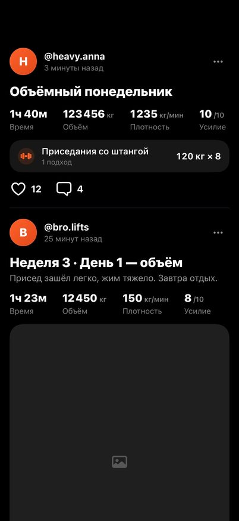
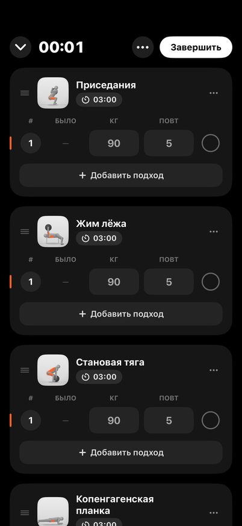
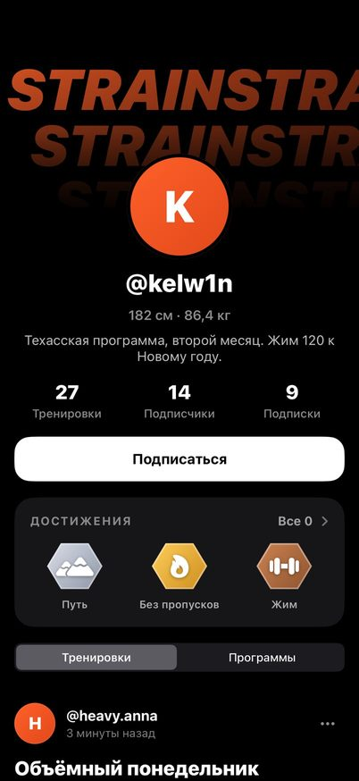
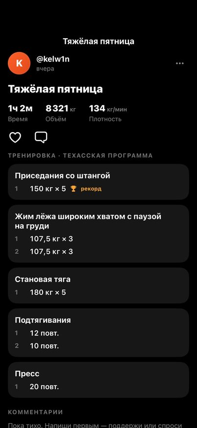
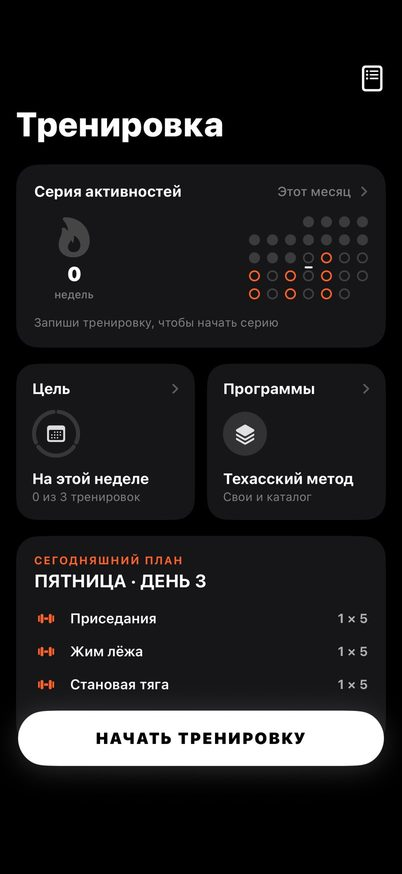
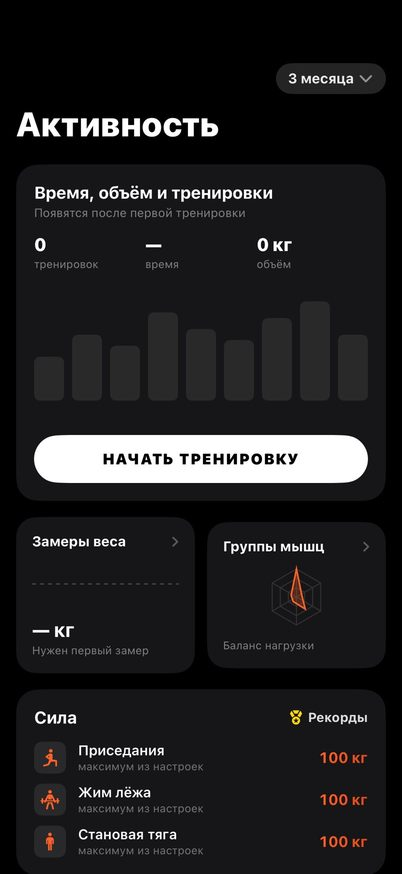
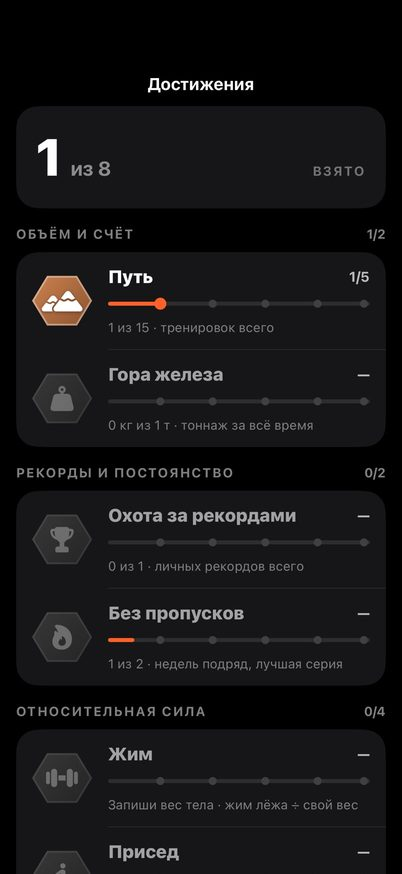
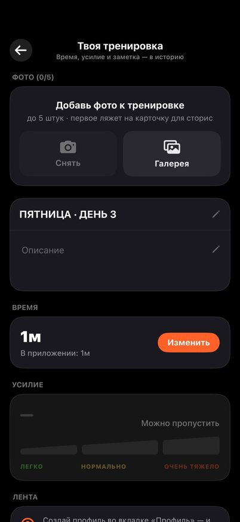

# STRAIN

Дневник силовых тренировок для iPhone и Android: готовые программы с расчётом
весов, отметка подходов прямо в зале, таймер отдыха, прогресс и лента, куда
вы с друзьями выкладываете тренировки с фото.

  
  
  
  

  
  
  
  

## Программы

- **Техасский метод** — 12 недель, 3 тренировки в неделю, расчёт по 5ПМ;
- **Верх / Низ** — 7 недель, 4 тренировки, волна жима «Жим 14» по 1ПМ;
- **Фулбади** — 12 недель, всё тело каждую тренировку;
- **Продвинутый техас** — 20 недель, 10 двухнедельных блоков;
- **Эвтаназия худобы** — 8 недель, прогрессия по плотности;
- **Своя программа** — свои упражнения, схема и недели.

Можно вести несколько профилей — у каждого своя программа, максимумы и история.

## Тренировка

- расписание по дням недели или очередью, «Сегодня / Завтра / Через N дней»;
- вес и повторы с клавиатуры, «было» подставляет прошлый раз, рекорд отмечается кубком;
- закрытый подход сам запускает отдых: таймер поверх экрана, в Dynamic Island
  и на экране блокировки (на Android — в уведомлении);
- упражнения переставляются перетаскиванием, тренировка переживает выгрузку приложения;
- разбор веса по блинам и разминочные подходы;
- шаг прибавки, предупреждение о застое, автоматическое пикирование;
- итоги тренировки: время, усилие, заметка, фото и карточка для сторис.

## Прогресс

- серия тренировок с календарём месяца и цель недели;
- рабочий объём, рекорды, график весов приседа, жима и тяги;
- замеры веса тела и сила относительно веса;
- достижения с уровнями: путь, тоннаж, рекорды, серия, жим, присед, тяга, троеборье.

## Лента с друзьями

- профиль с аватаром, обложкой, достижениями и вкладкой «Программы»;
- в конце тренировки — фото прямо из приложения, и пост уходит в ленту вместе
  с упражнениями, весами и подходами;
- лента «Главное» (все в STRAIN) и «Подписки», поиск людей по юзернейму;
- лайки и комментарии под постами;
- нет связи — пост ждёт на телефоне и уходит сам.

Сервер ленты — `server/` (Node + Postgres), подробности в [server/README.md](server/README.md).

## Устройство репозитория

| Папка | Что внутри |
| --- | --- |
| `TexasProgram/` | приложение для iPhone: SwiftUI, SwiftData, iOS 17+ |
| `StrainWidgets/` | виджеты и Live Activity таймера отдыха |
| `TexasProgramTests/` | тесты iOS |
| `android/` | приложение для Android: Jetpack Compose |
| `server/` | сервер ленты |

Сборки делает GitHub Actions: `ios.yml` — IPA без подписи, `android.yml` — подписанный APK,
`snapshots.yml` — снимки экранов для проверки вёрстки (из них же картинки выше).

## Установка

**iPhone.** Скачай `TexasProgram-unsigned.ipa` из последней сборки iOS в Actions и
поставь через SideStore, Sideloadly или iloader со своим Apple ID. С бесплатным
Apple ID приложение нужно переподписывать раз в 7 дней.

**Android.** Скачай `strain-android-apk` из последней сборки Android и установи APK.
Новые версии ставятся поверх старой — профили и тренировки сохраняются.

## Важно

Стартовые 100 кг — демонстрационные значения. Перед тренировками протестируй свой
реальный 5ПМ или 1ПМ. Программа не заменяет консультацию тренера или врача.
